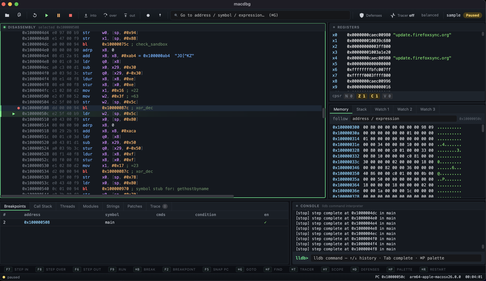
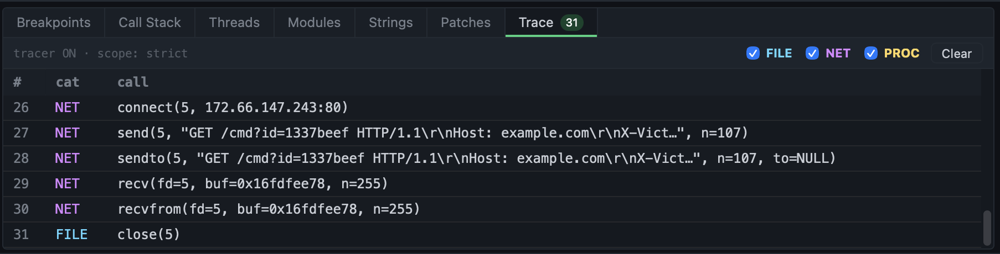
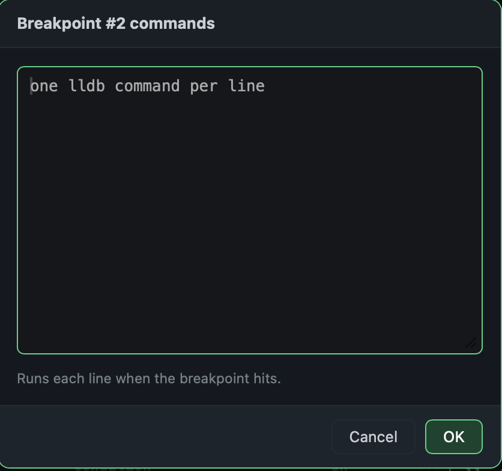
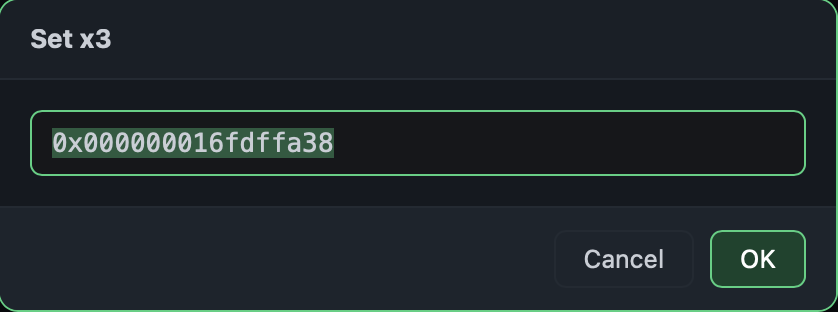
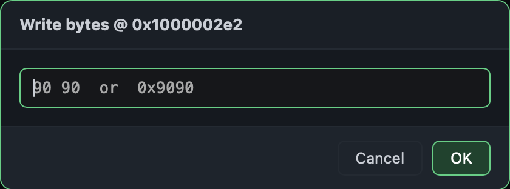
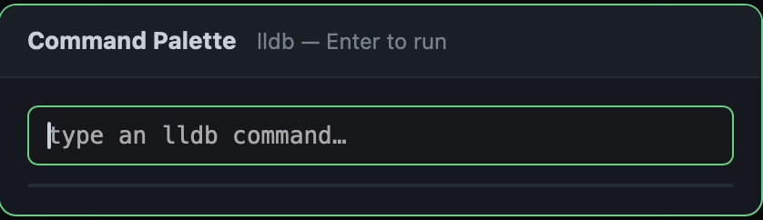
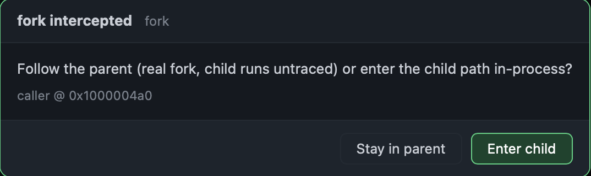
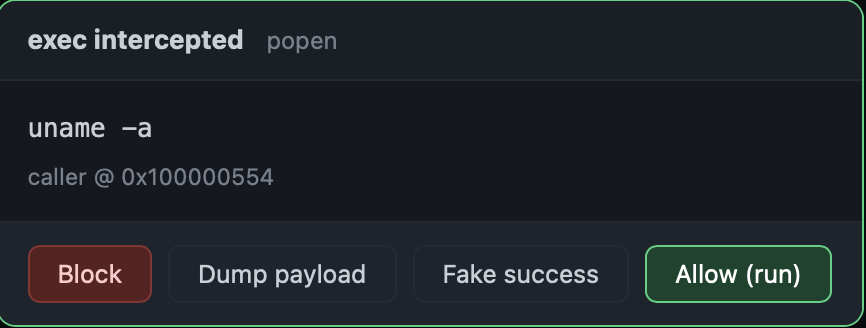

# macdbg

macdbg is an LLDB debugger for ARM64 macOS binaries. It has an x64dbg-style GUI and a headless interface for scripts.



## Quick start

On Apple Silicon, install the Xcode Command Line Tools with `xcode-select --install`, then clone and open the app.

```sh
git clone https://github.com/MZHeader/macdbg.git
cd macdbg
open macdbg.app
```

In the app, choose **File > Open Target** or **File > Attach to Process**. To launch a target from a terminal, run `GUI/run.sh /path/to/binary`.

The launcher uses pywebview for a native window when available and opens the interface in a browser otherwise.

## What you can do

- **CPU** shows disassembly, registers, stack and memory dumps together. Set breakpoints and watchpoints, edit registers and memory, or explore code in Graph, Symbols and References.
- **API Trace** (`⌘T`) records supported file, process and network calls. Inspect captured HTTP headers and bodies on supported paths, or export the trace as JSONL.
- **Time Machine** records instruction steps and lets you inspect earlier register and memory changes. **Patches** lets you export changes to a copy of the binary.
- **Defenses** (`⌘D`) has controls for debugging targets that perform anti-debug checks or fork during analysis.

## Headless

```sh
./agent.sh start --session demo /path/to/binary
./agent.sh status demo
./agent.sh stop demo
```

See the [command reference](.skills/macdbg-agent/references/commands.md) for the rest of the JSON interface.

## Documentation

- [GUI setup, offline installation and shortcuts](GUI/README-GUI.md)
- [Instruction recording, patches and environment controls](docs/historical-debugging.md)
- [Tests and trace coverage](docs/testing.md)

## Screenshots














